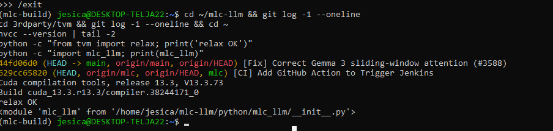
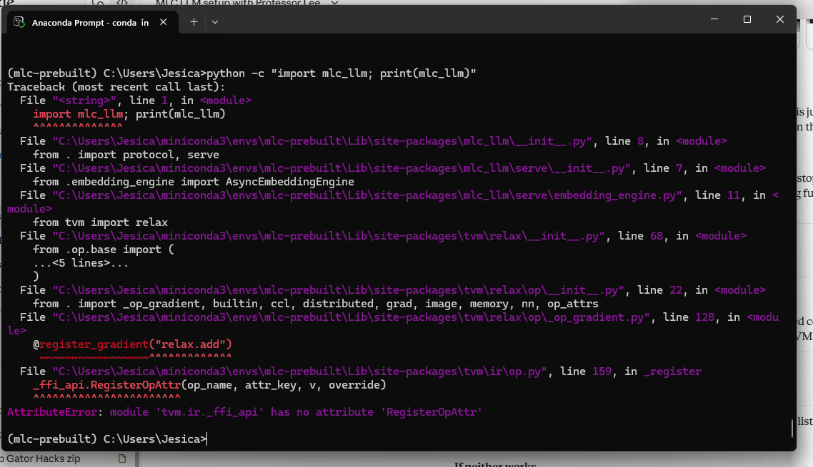
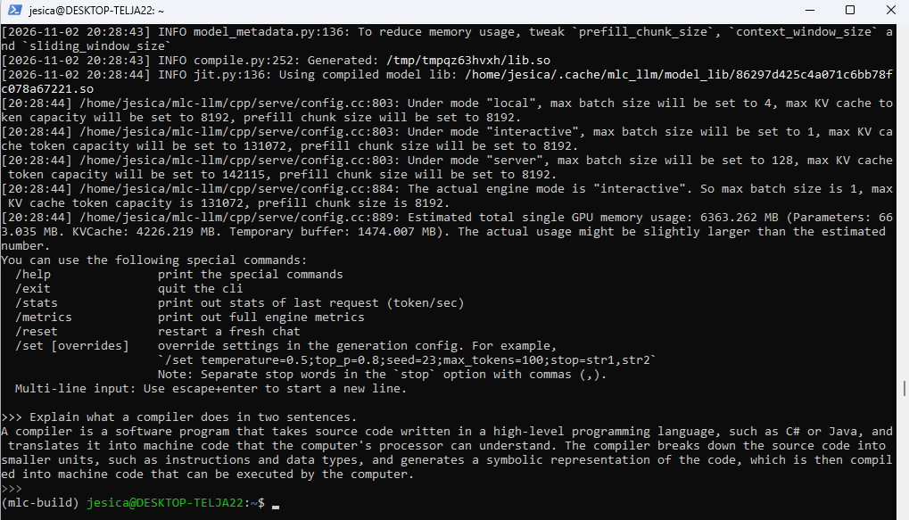
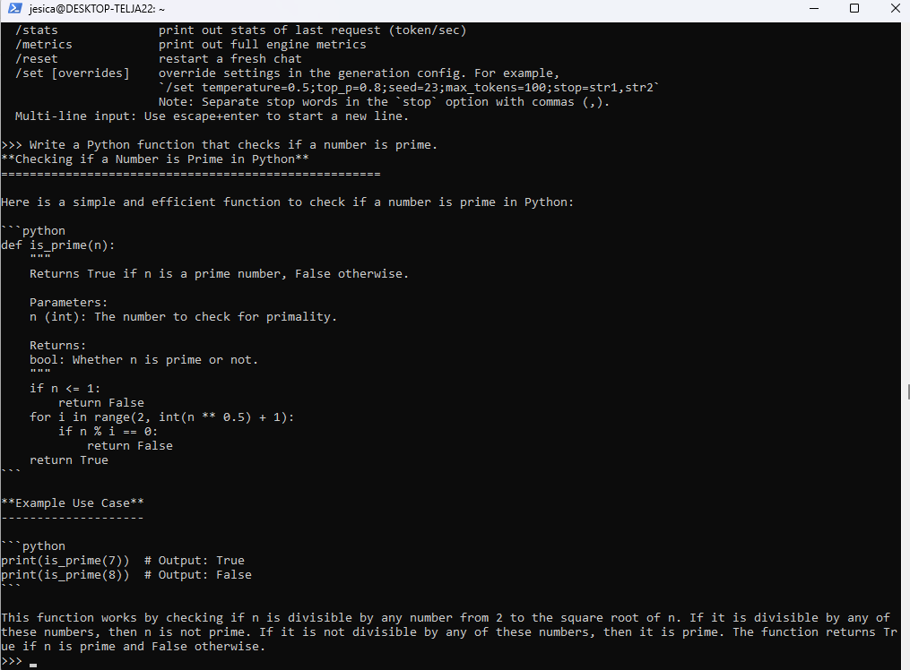
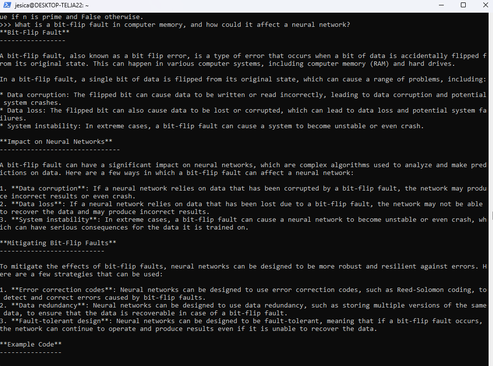
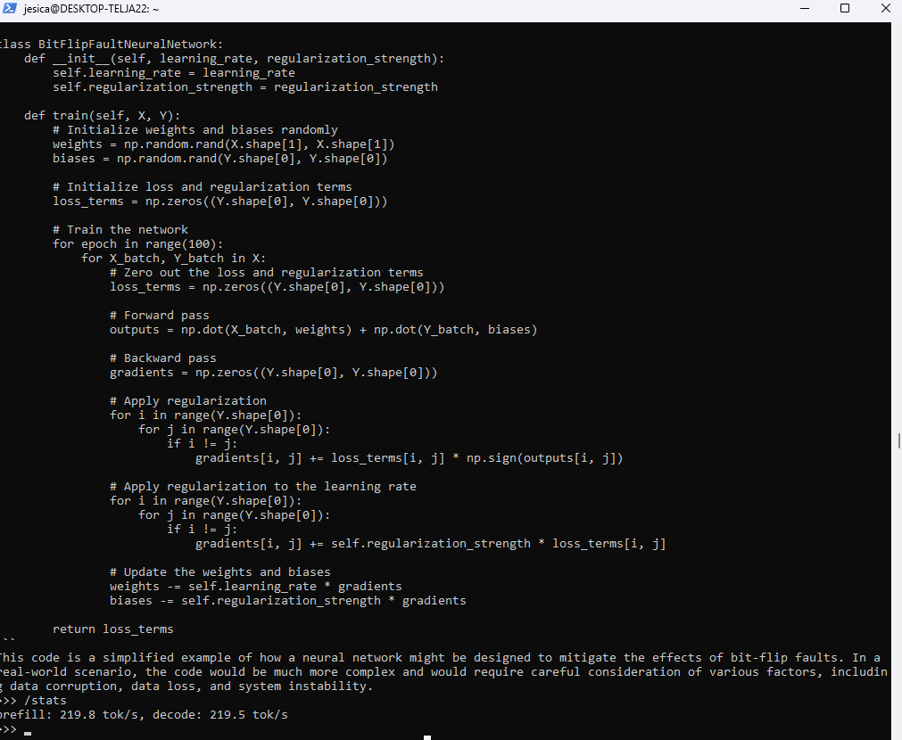
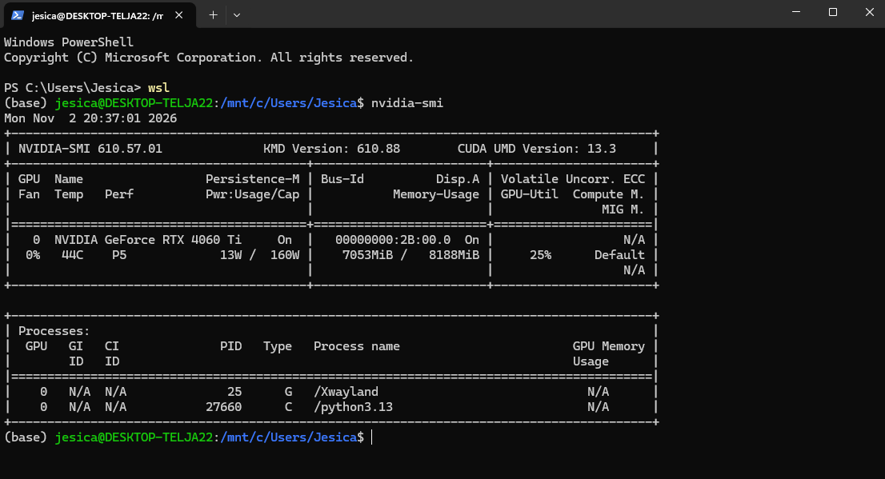

# MLC LLM: Local Build and Inference on a Consumer GPU

**Author:** Jesica Bermudes, B.S. Computer Science, University of Central Florida
**Date:** November 2, 2026

## Overview

This repository documents the installation of [MLC LLM](https://llm.mlc.ai/), a machine learning compiler and deployment engine for large language models, on a local workstation, along with LLM execution results.

The officially documented prebuilt package fails to import on Windows due to a version mismatch between the published MLC LLM and Apache TVM nightly packages. This report describes how the failure was diagnosed, the mitigations attempted, and how it was resolved by building TVM and MLC LLM from source under WSL2 with CUDA acceleration. Using the source build, Llama 3.2 1B Instruct (4-bit quantized) was compiled for and executed on an NVIDIA RTX 4060 Ti, reaching a decode throughput of **219.5 tokens/second**.

## Contents

1. [Environment](#1-environment)
2. [Prebuilt Package Evaluation](#2-prebuilt-package-evaluation)
3. [Building from Source](#3-building-from-source)
4. [Results](#4-results)
5. [Summary](#5-summary)
6. [References](#6-references)

---

## 1. Environment

### Hardware

| Component | Specification |
|---|---|
| GPU | NVIDIA GeForce RTX 4060 Ti, 8 GB VRAM |
| CPU | 12 logical cores |
| System memory | 32 GB (15 GB allocated to WSL2) |
| Storage | 2 TB NVMe SSD |

### Software

| Component | Version |
|---|---|
| Host operating system | Windows 11 |
| Build environment | WSL2, Ubuntu 26.04.1 LTS |
| NVIDIA driver | 610.88 (supports CUDA ≤ 13.3) |
| CUDA toolkit | 13.3 (nvcc V13.3.73) |
| GCC | 15.2.0 |
| CMake | 4.2.3 |
| LLVM | 21.1.8 |
| Python | 3.13.18 (conda environment) |
| Rust | 1.99.1 |

### Source Revisions

| Repository | Commit |
|---|---|
| [mlc-ai/mlc-llm](https://github.com/mlc-ai/mlc-llm) | `44fd06d0` |
| TVM (`3rdparty/tvm`, mlc-ai fork) | `629cc658` |
| TVM core (`3rdparty/tvm/3rdparty/tvm-tirx`) | `198a0457` (2026-10-20) |



---

## 2. Prebuilt Package Evaluation

### 2.1 Procedure

The prebuilt package was installed on native Windows following the [official installation guide](https://llm.mlc.ai/docs/install/mlc_llm). For Windows, the guide provides a single CPU + Vulkan option.

```bash
conda create --name mlc-prebuilt python=3.13
conda activate mlc-prebuilt
conda install -c conda-forge clang libvulkan-loader git-lfs git
python -m pip install --pre -U -f https://mlc.ai/wheels mlc-llm-nightly-cpu mlc-ai-nightly-cpu
```

Resolved package versions:

| Package | Version |
|---|---|
| `mlc-llm-nightly-cpu` | 0.26.dev20 |
| `mlc-ai-nightly-cpu` (TVM) | 0.26.dev529 |
| `apache-tvm-ffi` | 0.1.15.post2 |

### 2.2 Observed Failure

Verifying the installation with `python -c "import mlc_llm"` fails during the import of `tvm.relax`:

```
File ".../tvm/ir/op.py", line 159, in _register
    _ffi_api.RegisterOpAttr(op_name, attr_key, v, override)
AttributeError: module 'tvm.ir._ffi_api' has no attribute 'RegisterOpAttr'
```



### 2.3 Analysis

- The failure originates inside the TVM package (`mlc-ai-nightly-cpu`), not in MLC LLM itself: the Python layer calls a function that the compiled TVM library does not register.
- The identical error is tracked in open issue [mlc-ai/mlc-llm#3528](https://github.com/mlc-ai/mlc-llm/issues/3528), where it has also been reproduced on Windows. A comment on the issue notes that the function is present in the pinned TVM source, indicating the published binary does not match its source tree.
- Issue [mlc-ai/mlc-llm#3508](https://github.com/mlc-ai/mlc-llm/issues/3508) independently reports that the current `mlc-llm` and `mlc-ai` nightly packages are out of sync, reproduced on Linux and Google Colab.
- Only one nightly build of each package is published for Python 3.13 on Windows, so rolling back to an earlier matching pair was not possible.

### 2.4 Mitigations Attempted

| Attempt | Rationale | Outcome |
|---|---|---|
| `conda install zstd` | Documented fix for TVM library loading failures on Windows | Same error |
| Pin `apache-tvm-ffi==0.1.14` | Test whether the newer FFI layer caused the mismatch | Same error; version is yanked and violates the TVM package's requirement |
| Pin `apache-tvm-ffi==0.1.14.post1` | Oldest version satisfying the TVM package's requirement | Same error |

### 2.5 Conclusion

The failure is caused by an upstream packaging defect, not the local environment. Because the defect lies in the TVM binary, building only MLC LLM from source would not resolve it. Both **TVM and MLC LLM must be built from the same source tree** so that their interfaces match.

---

## 3. Building from Source

The build was performed in WSL2 so that the Linux build instructions could be followed as documented while retaining access to the local GPU through CUDA.

### 3.1 WSL2 Setup

```powershell
wsl --install -d Ubuntu
```

GPU visibility inside WSL2 was confirmed with `nvidia-smi`. GPU access is provided by the Windows driver; no Linux driver was installed.

### 3.2 System Dependencies

```bash
sudo apt install -y build-essential git git-lfs cmake ninja-build curl wget
sudo apt install -y llvm-dev
sudo apt install -y libzstd-dev zlib1g-dev libxml2-dev
```

### 3.3 CUDA Toolkit

CUDA 13.3 was installed to match the maximum version supported by the host driver. NVIDIA's installer defaulted to 13.4, which could produce GPU code the driver cannot run. Only the toolkit was installed.

```bash
wget https://developer.download.nvidia.com/compute/cuda/repos/ubuntu2604/x86_64/cuda-keyring_1.1-1_all.deb
sudo dpkg -i cuda-keyring_1.1-1_all.deb
sudo apt-get update
sudo apt-get -y install cuda-toolkit-13-3

echo 'export PATH=/usr/local/cuda-13.3/bin:$PATH' >> ~/.bashrc
echo 'export LD_LIBRARY_PATH=/usr/local/cuda-13.3/lib64:$LD_LIBRARY_PATH' >> ~/.bashrc
source ~/.bashrc
```

### 3.4 Python Environment

The environment was created from conda-forge exclusively (`--override-channels`), which avoids the Terms of Service requirement attached to Anaconda's default channels.

```bash
conda create -n mlc-build --override-channels -c conda-forge python=3.13 rust -y
conda activate mlc-build
```

### 3.5 Source Checkout

```bash
git clone --recursive https://github.com/mlc-ai/mlc-llm.git
```

### 3.6 Building TVM

```bash
cd ~/mlc-llm/3rdparty/tvm
mkdir build && cd build
cmake .. -G Ninja \
  -DCMAKE_BUILD_TYPE=RelWithDebInfo \
  -DCMAKE_POLICY_VERSION_MINIMUM=3.5
ninja -j8
```

Resulting configuration (from `cmake -LA -N build`):

| Option | Value |
|---|---|
| `TVM_TIRX_USE_LLVM` | `ON` (LLVM 21.1.8) |
| `TVM_TIRX_USE_CUDA` | `AUTO` (CUDA 13.3 detected) |
| `TVM_HIDE_PRIVATE_SYMBOLS` | `ON` |
| `TVM_USE_CUBLAS` | `OFF` |

Notes:

- This TVM revision no longer ships `cmake/config.cmake` and has renamed its build options (`USE_CUDA` is now `TVM_TIRX_USE_CUDA`, and so on). Options passed under the old names were ignored, but LLVM and CUDA were detected and enabled automatically. cuBLAS, which is optional for MLC LLM, was left disabled.
- `CMAKE_POLICY_VERSION_MINIMUM=3.5` maintains compatibility with CMake 4.x.
- The build used 8 parallel jobs rather than 12 to limit peak memory usage. It completed in approximately 20 minutes and produced `libtvm_compiler.so`, `libtvm_runtime.so`, `libtvm_runtime_cuda.so`, and `libtvm_ffi.so` under `build/lib/`.

### 3.7 Installing TVM into Python

Following TVM's documented environment-variable method, which uses the existing build without recompiling:

```bash
export TVM_HOME=$HOME/mlc-llm/3rdparty/tvm
pip install --target=$TVM_HOME/python $TVM_HOME/3rdparty/tvm-tirx/3rdparty/tvm-ffi
export PYTHONPATH=$TVM_HOME/3rdparty/tvm-tirx/python:$TVM_HOME/python:$PYTHONPATH
export TVM_TIRX_LIBRARY_PATH=$TVM_HOME/build/lib
pip install numpy decorator attrs typing-extensions psutil scipy ml_dtypes cloudpickle
```

Verification:

```bash
python -c "from tvm import relax; print('relax OK')"                  # relax OK
python -c "import tvm_tirx; print('CUDA:', tvm_tirx.cuda(0).exist)"   # CUDA: True
```

The `tvm.relax` import, which failed with the prebuilt package, succeeds with the source build, and TVM detects the GPU.

### 3.8 Building and Installing MLC LLM

```bash
cd ~/mlc-llm
mkdir -p build && cd build
python ../cmake/gen_cmake_config.py   # TVM_SOURCE_DIR=3rdparty/tvm, CUDA=ON, all other backends OFF
sed -i 's/set(USE_THRUST ON)/set(USE_THRUST OFF)/' config.cmake
cmake .. -G Ninja -DCMAKE_POLICY_VERSION_MINIMUM=3.5 -DCMAKE_CUDA_ARCHITECTURES=89
ninja -j8
```

Notes:

- **Thrust incompatibility.** The first build failed compiling TVM's Thrust integration (`src/runtime/extra/contrib/thrust/thrust.cu`) with `namespace "thrust" has no member "make_tuple"`. That API is not available in the Thrust version bundled with CUDA 13.3. Since Thrust is an optional dependency with a fallback in TVM, it was disabled.
- **GPU architecture.** The build defaulted to `compute_75`. It was set to `89` (Ada Lovelace) to generate code for the RTX 4060 Ti.

Installation and verification:

```bash
export MLC_LLM_SOURCE_DIR=$HOME/mlc-llm
export PYTHONPATH=$MLC_LLM_SOURCE_DIR/python:$PYTHONPATH
alias mlc_llm="python -m mlc_llm"

python -c "import mlc_llm; print(mlc_llm)"
# <module 'mlc_llm' from '/home/jesica/mlc-llm/python/mlc_llm/__init__.py'>
mlc_llm chat -h   # prints CLI usage
```

---

## 4. Results

### 4.1 Setup

| Parameter | Value |
|---|---|
| Model | `mlc-ai/Llama-3.2-1B-Instruct-q4f16_1-MLC` |
| Quantization | `q4f16_1` (4-bit weights, FP16 activations) |
| Device | CUDA (RTX 4060 Ti) |
| Engine mode | Interactive (batch size 1) |
| Context window | 131,072 tokens (model default) |

```bash
git lfs install
mlc_llm chat HF://mlc-ai/Llama-3.2-1B-Instruct-q4f16_1-MLC --device cuda
```

On first run, MLC LLM downloaded the weights and JIT-compiled a CUDA model library (`compile.py: Generated .../lib.so`) using the source-built TVM, confirming the full compilation pipeline works end to end.



### 4.2 Execution

Three prompts were evaluated: a short explanation, a code-generation task, and a question related to fault tolerance.

| Prompt | Result |
|---|---|
| "Explain what a compiler does in two sentences." | Correct, concise explanation of compilation from source code to machine code |
| "Write a Python function that checks if a number is prime." | Correct `is_prime` implementation using trial division up to √n, with docstring and usage examples |
| "What is a bit-flip fault in computer memory, and how could it affect a neural network?" | Accurate high-level explanation (data corruption, system instability) and mitigations (error-correcting codes, redundancy, fault-tolerant design). The accompanying example code was generic training code unrelated to fault tolerance, which reflects the limited reasoning capacity of a 1B-parameter model. |

Prompt 1 appears in the model loading screenshot above.




### 4.3 Throughput

Reported by `/stats` after the third prompt:

| Metric | Throughput |
|---|---|
| Prefill | 219.8 tokens/s |
| Decode | 219.5 tokens/s |

Because the prompt was short, the prefill figure is based on very few tokens and is less representative of prefill performance than the decode figure.



### 4.4 GPU Memory

| Measurement | Value |
|---|---|
| MLC estimate: model parameters | 663.0 MB |
| MLC estimate: KV cache | 4,226.2 MB |
| MLC estimate: temporary buffer | 1,474.0 MB |
| **MLC estimate: total** | **6,363.3 MB** |
| `nvidia-smi`, idle (before loading) | 775 MiB |
| `nvidia-smi`, model loaded | 7,053 MiB / 8,188 MiB |

The observed increase of about 6.3 GB closely matches MLC's estimate, and `nvidia-smi` shows `python3.13` running as a compute (`C`) process on the GPU.



**Observation.** The model weights account for only about 10% of the memory footprint. The KV cache accounts for about 66%, because MLC reserves cache space for the model's full 131,072-token context window. For memory-constrained or embedded deployment, reducing `context_window_size` (e.g. `--overrides "context_window_size=4096"`) would therefore be the most effective way to shrink the footprint, much more than further weight quantization.

---

## 5. Summary

- The officially documented prebuilt MLC LLM package is currently unusable on Windows because of a version mismatch between the published MLC LLM and TVM nightly binaries (mlc-ai/mlc-llm#3528, #3508). Dependency pinning did not resolve it.
- Building TVM and MLC LLM together from source under WSL2 resolved the issue. Two additional build incompatibilities with the newest toolchain were resolved along the way: renamed TVM build options and a Thrust API removed in CUDA 13.3.
- Llama 3.2 1B Instruct (4-bit) was compiled for and executed on an RTX 4060 Ti at **219.5 tokens/s decode**, using about **6.3 GB of GPU memory**, most of which is KV cache for the default 131K-token context.

---

## 6. References

1. MLC LLM documentation: https://llm.mlc.ai/docs/
2. MLC LLM installation guide: https://llm.mlc.ai/docs/install/mlc_llm
3. Apache TVM, Install from Source: https://tvm.apache.org/docs/install/from_source.html
4. mlc-ai/mlc-llm#3528, `AttributeError: module 'tvm.ir._ffi_api' has no attribute 'RegisterOpAttr'`: https://github.com/mlc-ai/mlc-llm/issues/3528
5. mlc-ai/mlc-llm#3508, mlc-llm/mlc-ai nightly package desync: https://github.com/mlc-ai/mlc-llm/issues/3508
6. Model weights: https://huggingface.co/mlc-ai/Llama-3.2-1B-Instruct-q4f16_1-MLC
